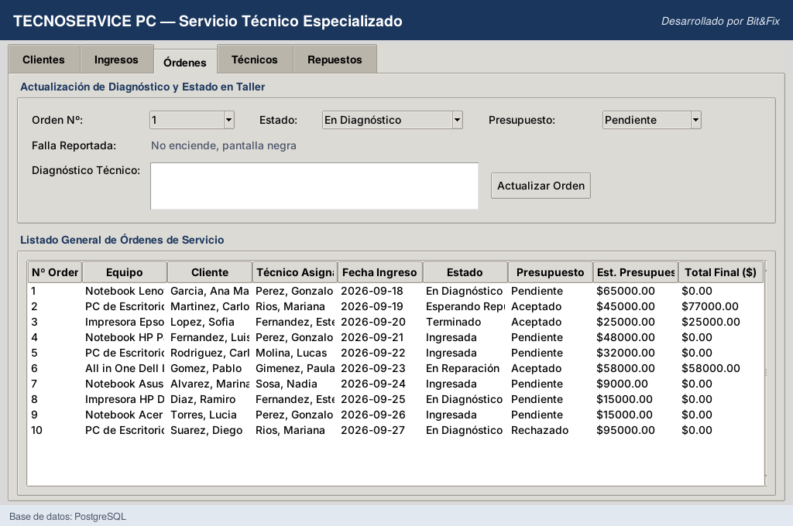
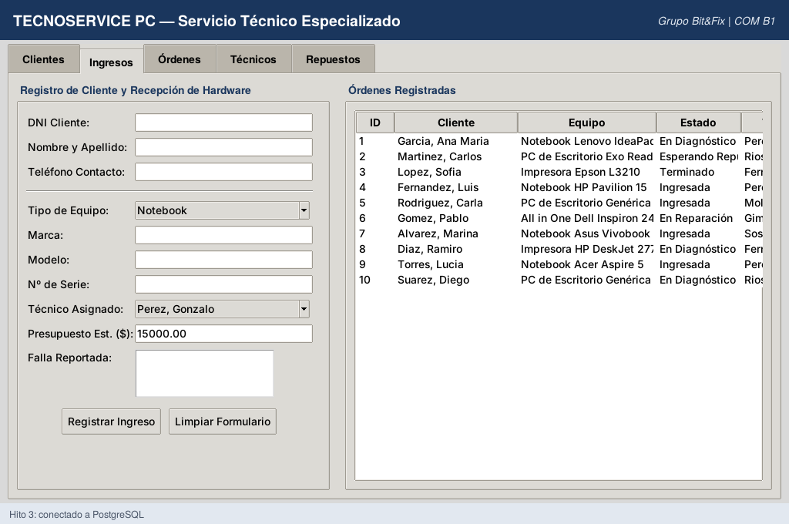
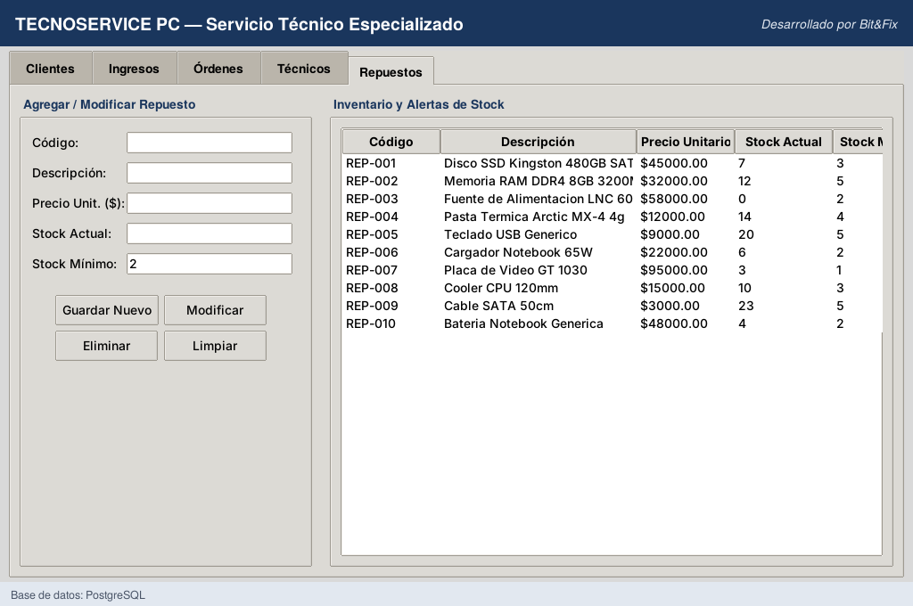
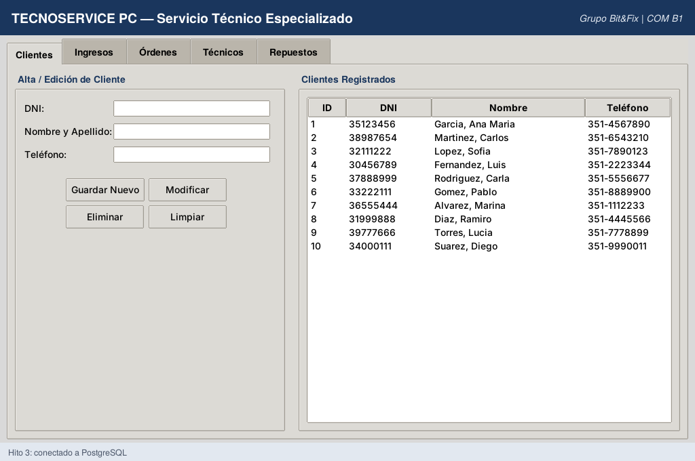
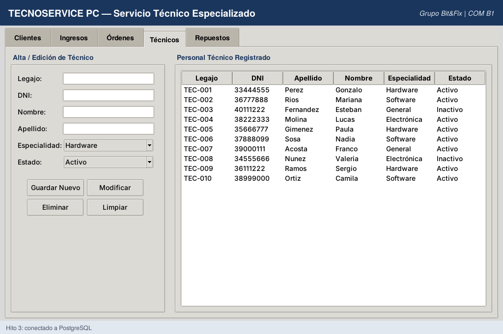

# TecnoService · Sistema de gestión para talleres de reparación de PC

Aplicación de escritorio para administrar un taller de servicio técnico informático: desde que un equipo entra al local hasta que se entrega reparado, con presupuesto, técnico asignado y control de repuestos.



## Qué problema resuelve

En un taller chico, los ingresos se anotan en papel o en planillas sueltas: se pierde qué equipo es de quién, en qué estado está cada reparación y si el cliente aprobó el presupuesto. TecnoService reúne todo en un solo sistema con una base de datos que no deja cargar información incoherente.

Algunas reglas que el sistema hace cumplir:

- **No se repara sin presupuesto aceptado.** Una orden no puede pasar a *En Reparación*, *Terminado* o *Entregado* si el cliente no aprobó el presupuesto. La regla está en la base de datos, así que se cumple aunque alguien intente saltearla.
- **No se usa un repuesto que no hay.** Un trigger en PostgreSQL controla el stock antes de asignar un repuesto a una reparación y lo descuenta automáticamente.
- **Los datos tienen que tener sentido:** precios positivos, stock nunca negativo, fecha de salida posterior a la de ingreso y estados de una lista fija.

## Funcionalidades

| Pestaña | Qué permite |
|---|---|
| **Clientes** | Alta, modificación y baja de clientes |
| **Ingresos** | Recepción del equipo: cliente, tipo, marca, modelo, número de serie, falla, técnico asignado y presupuesto estimado |
| **Órdenes** | Seguimiento de cada reparación: diagnóstico, estado y respuesta del cliente al presupuesto |
| **Técnicos** | Alta, modificación y baja de técnicos, con especialidad y estado |
| **Repuestos** | Inventario con precios y aviso de **stock bajo** cuando un repuesto llega al mínimo |

<p>
  
  
</p>
<p>
  
  
</p>

## Tecnologías

- **Python 3.12** con **Tkinter / ttk** para la interfaz (pestañas, formularios y tablas)
- **PostgreSQL** alojado en **Neon**, con **psycopg2** y consultas SQL parametrizadas
- Modelo entidad-relación normalizado a **3FN**: 6 tablas con claves foráneas, restricciones `CHECK`, un trigger en PL/pgSQL y roles de base de datos (administrador, técnico y recepción)
- **Git y GitHub** para el control de versiones

## Cómo probarlo

**Requisitos:** Python 3.12 o superior y una base PostgreSQL (sirve un proyecto gratuito de [Neon](https://neon.tech)).

1. Descargá el repositorio: **Code → Download ZIP**, o con `git clone`.
2. Instalá la librería de PostgreSQL:
   ```
   pip install psycopg2-binary
   ```
3. Creá las tablas y los datos de prueba ejecutando `sql/script_tecnoservice.sql` en tu base (en Neon, desde el **SQL Editor**).
4. Copiá el archivo `.env.example` como `.env`, en la carpeta principal del proyecto, y completalo con los datos de tu base.
5. Abrí una terminal en la carpeta `src` y ejecutá:
   ```
   python main.py
   ```

Los datos de conexión no se suben al repositorio: el archivo `.env` está excluido en `.gitignore`.

## Estructura

```
/
├── src/
│   ├── main.py            # Punto de entrada
│   ├── interfaz.py        # Interfaz gráfica (Tkinter)
│   ├── acceso_datos.py    # Consultas SQL
│   └── conexion.py        # Conexión a PostgreSQL (lee el .env)
├── sql/
│   └── script_tecnoservice.sql   # Tablas, restricciones, trigger, roles y datos de prueba
├── Docs/                  # Requerimientos, modelo relacional, diccionario de datos e informes
│   └── capturas/          # Capturas para este README
├── .env.example           # Plantilla de configuración
└── README.md
```

## Equipo

Proyecto integrador del módulo Programador de la Tecnicatura Superior en Desarrollo de Software (ISPC), desarrollado por el equipo **Bit&Fix** (2026).

| Integrante | Rol |
|---|---|
| **Ricardo Kieffer** | Coordinación del equipo, control de versiones en Git, validación de formularios y manejo de errores |
| Juan Jerónimo | Modelo de datos y script SQL |
| Joaquín Bileisis | Interfaz gráfica |
| Thiago Espinosa | Documentación y pruebas |

**Contacto:** [LinkedIn](https://www.linkedin.com/in/ricardo-kieffer) · [GitHub](https://github.com/ricardokieffer)
